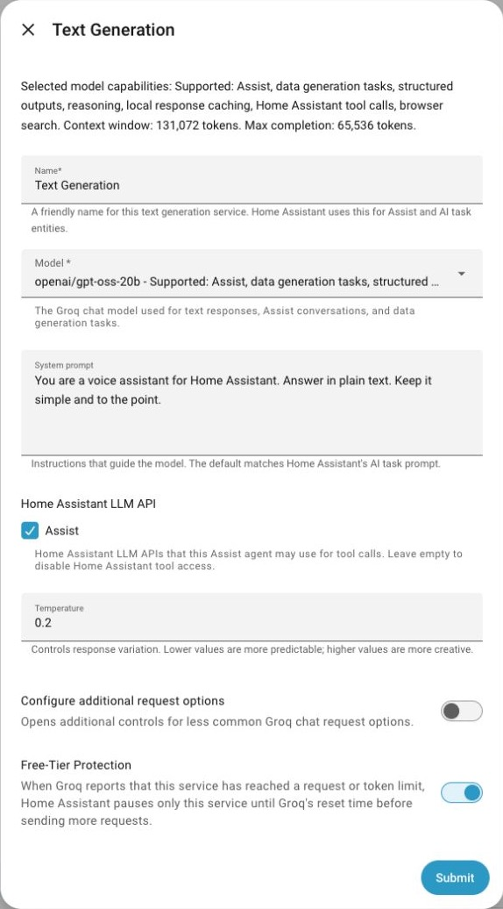
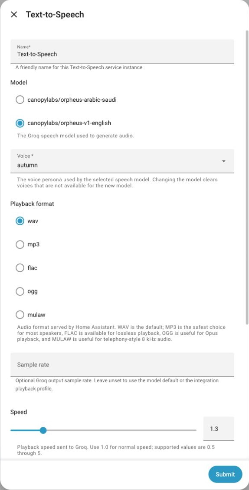
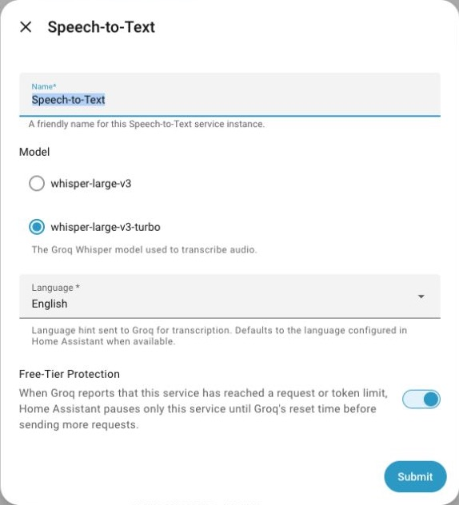
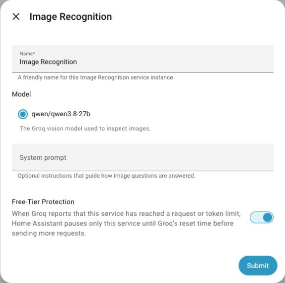

<picture>
  <source media="(prefers-color-scheme: dark)" srcset="docs/images/readme-banner-dark.png">
  <source media="(prefers-color-scheme: light)" srcset="docs/images/readme-banner-light.png">
  
</picture>

  
  

Bring Groq to Assist, voice pipelines and automations in Home Assistant.

  <a href="#get-started">Install</a> ·
  <a href="#key-features">Features</a> ·
  <a href="#at-a-glance">Screenshots</a> ·
  <a href="https://github.com/barneyonline/ha-groq/wiki">Documentation</a>

> [!IMPORTANT]
> This is an unofficial community project, not affiliated with, endorsed by, or supported by Groq. Model availability, limits and billing are controlled by Groq and can vary by account, project and model.

## Key features

- **Assist conversations:** Streaming replies, Home Assistant tools and optional browser search with citations.
- **AI Tasks and automations:** Generate text and validated structured output.
- **Speech recognition:** Voice pipelines, recorded-audio transcription and translation into English.
- **Text-to-speech:** Orpheus voices, playback options and optional Long TTS.
- **Image recognition:** Analyze camera and media images, and extract text.
- **Usage and diagnostics:** Optional token and response-time sensors, local caching and per-service rate-limit protection.

## At a glance

Configure an Assist agent and a voice for your announcements.

<!-- Inline images wrap onto separate rows on narrow screens. Keep their natural proportions. -->

  
  &nbsp;
  

More screenshots · speech recognition and image analysis

### Speech-to-Text and Image Recognition

  
  &nbsp;
  

## Get started

1. [Open Groq in HACS](https://my.home-assistant.io/redirect/hacs_repository/?owner=barneyonline&repository=ha-groq&category=integration), download it and restart Home Assistant.
2. Go to **Settings → Devices & services → Add integration → Groq**.
3. Add your [Groq API key](https://console.groq.com/), then add Text Generation, Speech-to-Text, Text-to-Speech or Image Recognition services.

Requires **Home Assistant 2026.10.0+**, a Groq API key and internet access. Some audio processing options require `ffmpeg`.

Enter your Home Assistant URL if prompted by the HACS link. See [Installation](https://github.com/barneyonline/ha-groq/wiki/Installation) for manual setup.

## Documentation

[Open the wiki](https://github.com/barneyonline/ha-groq/wiki) for setup, usage and troubleshooting.

| Guide | Covers |
| --- | --- |
| [Account and service setup](https://github.com/barneyonline/ha-groq/wiki/Account-and-Service-Setup) | API keys and named services |
| [Text Generation](https://github.com/barneyonline/ha-groq/wiki/Text-Generation) | Assist, AI Tasks and text actions |
| [Speech-to-Text](https://github.com/barneyonline/ha-groq/wiki/Speech-to-Text) | Transcription and translation |
| [Text-to-Speech](https://github.com/barneyonline/ha-groq/wiki/Text-to-Speech) | Voices and playback options |
| [Image Recognition](https://github.com/barneyonline/ha-groq/wiki/Image-Recognition) | Image analysis and text extraction |
| [Usage and diagnostics](https://github.com/barneyonline/ha-groq/wiki/Usage-and-Diagnostics) | Sensors, usage scope and diagnostics |
| [Troubleshooting](https://github.com/barneyonline/ha-groq/wiki/Troubleshooting) | Authentication, models and request failures |
| [Development](https://github.com/barneyonline/ha-groq/wiki/Development) | Tests and contributions |

Full configuration, action examples, limitations and removal: **[Groq user guide](docs/user-guide.md)**.

Compatibility and service limits

Groq is a cloud service. Models and request options vary by account and can change. Long TTS uses additional CPU and API quota. Local media and audio actions retain administrator and allowed-path restrictions.

The user guide covers [supported functionality](docs/user-guide.md#supported-functionality), [configuration and cache budgets](docs/user-guide.md#configuration), [browser search](docs/user-guide.md#streaming-and-browser-search), [sensor scope](docs/user-guide.md#usage-sensors), [known limitations](docs/user-guide.md#known-limitations) and [removal](docs/user-guide.md#removal).

---

The Platinum quality-scale label is a repository self-assessment against the current Home Assistant integration quality rules. As a custom integration, ha-groq is not reviewed, security audited, maintained, or supported by the Home Assistant project. The rule-by-rule evidence is tracked in [`quality_scale.yaml`](quality_scale.yaml).
